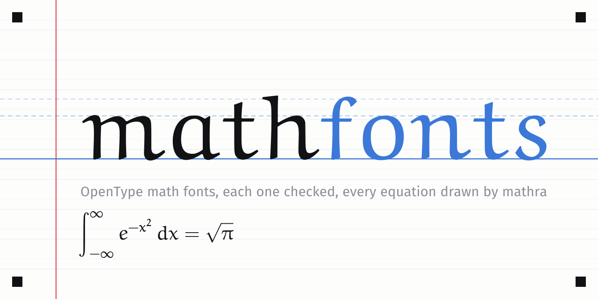

# mathfonts



A catalog of OpenType math fonts. Each font is checked, and every equation on the site is drawn by [mathra](https://github.com/matheusmota-dev-br/mathra) in that font, so you see what a font does to a fraction, a sum or a Greek letter before you download it.

The catalog has 23 fonts, all free to share: STIX Two, Latin Modern, New Computer Modern, the TeX Gyre fonts, Libertinus, Fira, Noto Sans, Euler, Garamond and others. Each one comes as its authors published it, with its license.

## What the site shows

- **Fonts**: a grid of every font with the same equation. You can switch the equation, filter by style and sort by how many math symbols a font has.
- **A page per font**: specimens, the checks it passed, how many of the math symbols mathra draws it has, block by block, with the ones it lacks, and the download.
- **Every glyph**: for each font, all its glyphs in the boxes of the printed grid, with what it lacks marked.
- **Compare**: the same equations in up to three fonts, side by side.
- **Add your font**: how to send a font with a pull request.

## Adding a font

Add a folder under `fonts/` with the font file, its license and a `font.toml`, then open a pull request. A check comments on it with what passed and how many math symbols the font has. A draft pull request gets the report too. See [CONTRIBUTING.md](CONTRIBUTING.md).

## How it works

```
fonts/<slug>/            the font file, LICENSE.txt and font.toml
equations/gallery.json   the equations every font must draw (mathra's gallery)
src/                     the mathfonts tool: checks fonts and builds the site
site/                    the site's style.css and app.js
scripts/refresh.py       downloads every font again from upstream and compares
scripts/brand.py         draws the banner and the favicon from the catalog's fonts
scripts/grid.py          builds the grids for drawing a math font by hand (large and compact) in site/grid/
scripts/hand.py          makes a math font from photos of the filled-in grid (Pencil Math was made with it)
```

```sh
cargo run --release -- check                      # check every font
cargo run --release -- check fonts/euler-math --report report.md
cargo run --release -- build                      # check every font, build the site in dist/
python3 scripts/refresh.py                        # compare every font with its upstream file
```

To see the site, serve `dist/` (for example `python3 -m http.server -d dist`). Opening the files directly does not work: the grid and the comparison load their equations with `fetch`.

### The checks

A font joins the catalog only if:

- it is an OpenType or TrueType file with a **MATH table**, which mathra needs to set fractions, radicals, scripts and tall delimiters;
- its license lets the catalog share the file (OFL 1.1, GUST, Apache 2.0 or MIT), and the license text is next to it;
- mathra loads it;
- no other font in the catalog has its name.

Two things are measured but do not block a font:

- whether mathra draws the 44 equations of its gallery in it;
- how many of the 2101 math symbols mathra draws it has (Greek, math letters, operators, arrows, letterlike symbols).

### The workflows

- `check.yml`: on a pull request that touches `fonts/`, checks the fonts it adds or changes and comments the report. It builds the tool from the base branch and reads only the pull request's `fonts/` folder.
- `pages.yml`: on `main`, runs the tests, builds the site and publishes it on GitHub Pages.
- `upstream.yml`: every Monday, downloads each font again from its `[upstream]` and opens an issue when one changed.

## Credits

The fonts belong to their authors and keep their licenses: see `fonts/<slug>/LICENSE.txt`. Most come from [CTAN](https://ctan.org); Noto Sans Math comes from [Google Fonts](https://github.com/google/fonts). The equations in `equations/gallery.json` are mathra's gallery.
